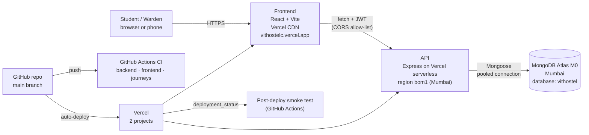

# Architecture

How the VIT Hostel Complaint System works, where everything lives, how to run it, and what comes next.

- **Live site:** https://vithostelc.vercel.app
- **API:** https://vit-hostel-complaint-system.vercel.app (health check: `/api/health`)

## 1. What it does

Students sign up with their university email and file complaints about their hostel room (electricity, water, WiFi, room change, other). Wardens see every complaint, filter and page through them, and move each one from **Pending → In Progress → Completed**. Students see the status change. Wardens can reset a student's forgotten password; the student must then choose a new one.

## 2. System overview



| Layer | Technology | Why it was chosen |
|---|---|---|
| Frontend | React 18, Vite 6, plain CSS | Simple single-page app; Vite builds a small static bundle (~53 KB gzipped) that a CDN can serve |
| API | Express 5 (Node 22), Vercel serverless functions | Familiar, minimal; serverless is free and needs no server to manage. Express 5 forwards async errors to one error handler. |
| Database | MongoDB Atlas (free M0, Mumbai) + Mongoose 8 | Complaints are documents; the free tier is enough; Mongoose gives schemas and validation |
| Auth | bcrypt (cost 12) + JWT (HS256, 1 day) with a `tokenVersion` | Stateless sessions that can still be revoked (password change, reset, logout) |
| Hosting | Vercel (frontend + API as two projects) | Free, deploys on every push, HTTPS and CDN included |
| CI/CD | GitHub Actions + Vercel Git integration | Tests on every push/PR; production deploys are smoke-tested automatically |

### What happens when a student submits a complaint

1. **Form:** `ComplaintForm.jsx` checks the fields in the browser, then `App.jsx` → `api.js` sends `POST /api/complaints` with the login token in the `Authorization` header.
2. **Vercel:** routes the request to the API function in Mumbai.
3. **Middleware:** `app.js` adds security headers, checks CORS (only the site's own address is allowed), parses JSON, and confirms config and database are ready (`requireReady`).
4. **Auth:** `middleware/auth.js` → `protect` verifies the token, loads the user, and checks `tokenVersion`; `requirePasswordChanged` and `allowRoles('student')` enforce the rules.
5. **Route:** `routes/complaints.js` validates the input (hostel/block, type, lengths), applies the rate limits (10 per hour, 3 urgent per day), rejects a duplicate sent within 10 minutes, then saves via `models/Complaint.js`.
6. **Response:** the API returns the saved complaint; the app adds it to "My Complaints". Any error comes back as `{ message }` with the right status code (400, 401, 403, 409, 429, 503).

## 3. Repository layout

```
VIT-hostel-complaint-system/
├── README.md              Front page: what it is, live link, features
├── ARCHITECTURE.md        This file
├── DEPLOY.md              Operations manual: setup, env vars, release checklist, rollback, troubleshooting
├── CLAUDE.md              One line: imports version-1/ai-docs/CLAUDE.md for Claude Code
├── docs/
│   └── TESTING.md         How the tests work, commands, regression map, what isn't tested
├── .github/workflows/
│   ├── ci.yml             Runs on every push/PR: backend tests, frontend tests + build, full-stack journeys
│   └── post-deploy.yml    After each production deploy: checks health, frontend + CSP, auth endpoint
├── backend/               Express API (Vercel project, root directory "backend")
├── vit-hostel/            React frontend (Vercel project, root directory "vit-hostel")
└── version-1/
    ├── legacy-html/       The original Review 1 version (plain HTML/CSS/JS), kept as history
    └── ai-docs/           AI-generated docs: Claude instructions, review checklist, scored review, memory notes
```

### backend/ (the API)

| File | What it does |
|---|---|
| `app.js` | Builds the Express app: security headers, CORS, JSON parsing, request logging, `/api/health`, mounts the routers, and the central error handler (maps DB outages → 503, duplicates → 409, version conflicts → 409). Never calls `listen()`. |
| `server.js` | Local development only: loads `.env`, checks `JWT_SECRET`, starts the app on port 5000 |
| `api/index.js` | Vercel's entry point: exports the app as the serverless handler |
| `vercel.json` | Pins the function region to `bom1` (Mumbai, next to the database) and sends every path to `api/index.js` |
| `routes/auth.js` | Register, login, `/me`, logout, change password, warden reset password |
| `routes/complaints.js` | Create a complaint (students), list your own (students), paged/filtered list with counts (wardens), change status (wardens) |
| `middleware/auth.js` | `protect` (token + user + tokenVersion), `allowRoles`, `requirePasswordChanged` |
| `models/User.js` | User schema: email (unique), role, reg number (unique for students), hostel/block/room, `tokenVersion`, `mustChangePassword`, reset audit fields. Hashes passwords on save. `toPublic()` strips private fields. |
| `models/Complaint.js` | Complaint schema: type, description, urgent, status, `resolvedAt`, `statusHistory`; optimistic concurrency; indexes for the list queries |
| `models/RateLimit.js` | Rate-limit counters with a TTL index (old counters delete themselves) |
| `lib/db.js` | Cached MongoDB connection (reused across serverless invocations; pool capped at 10) |
| `lib/config.js` | Required env checks, allowed origins (CORS), allowed email domains |
| `lib/constants.js` | Hostel blocks, complaint types, statuses, field length limits, reg-number format, rate-limit settings |
| `lib/validation.js` | `isBlank` (also blocks NoSQL injection by requiring real strings), length checks |
| `lib/passwordPolicy.js` | Password rules (8+ characters, not common), bcrypt cost, `hashPassword` (the only place passwords are hashed) |
| `lib/token.js` | Creates login tokens (`{ id, v }`, HS256, 1 day) |
| `lib/rateLimit.js` | MongoDB-backed rate limiter (shared by all serverless instances) |
| `lib/logger.js` | One JSON log line per request and per security event; never logs bodies, passwords or tokens |
| `lib/tempPassword.js` | Generates the warden-reset temporary passwords (cryptographically random) |
| `lib/indexes.js` | Logs failed index builds; `ensureIndexes()` adds missing indexes without dropping anything |
| `lib/seedPlan.js` | Decides what `seed.js` should do (create, update or refuse), kept separate so it can be unit-tested |
| `seed.js` | `npm run seed`: creates or updates the warden account |
| `scripts/db-indexes.js` | `npm run db:indexes`: adds any missing indexes to the real database |
| `test/` | Backend tests (node:test + supertest + in-memory MongoDB). See `docs/TESTING.md` |
| `.env.example` | Template for the local `backend/.env` (never commit the real one) |

### vit-hostel/ (the frontend)

| File | What it does |
|---|---|
| `src/main.jsx` | Starts React and renders `App` |
| `src/App.jsx` | The app's brain: restores the session, loads complaints (with a guard against stale responses), handles login/logout/expired sessions, decides which screen to show |
| `src/api.js` | Every API call goes through `apiRequest`: adds the token, applies a 15 s timeout, turns errors into friendly messages with a status |
| `src/constants.js` | Mirrors the backend constants (a backend test fails if they drift) |
| `src/components/LoginPage.jsx` | Login and student sign-up forms, with client-side checks |
| `src/components/StudentDashboard.jsx` | Student screen: complaint form + My Complaints + change password |
| `src/components/WardenPanel.jsx` | Warden screen: stats, status filter, paging, complaint cards, reset-password panel |
| `src/components/ComplaintForm.jsx` | The complaint form (prefilled from the student's profile) |
| `src/components/ComplaintList.jsx` | The student's complaint list with a type filter and Refresh |
| `src/components/ComplaintCard.jsx` | One complaint; wardens get the status buttons (disabled while saving) |
| `src/components/TopBar.jsx` | Shared header: role badge, Change password, Logout; short title on phones; skip link for wardens |
| `src/components/ChangePasswordForm.jsx` | Change password (also the forced screen after a warden reset) |
| `src/components/ResetPasswordPanel.jsx` | Warden tool: reset a student's password and show the temporary one (auto-hides after 60 s) |
| `src/App.css` | All styling; colours meet WCAG AA contrast |
| `src/journeys/` | Full-stack journey tests: the real app against the real API and an in-memory database |
| `src/test/setup.js` | Shared test setup |
| `public/` | Copied to the site as-is: `favicon.jpg`, `robots.txt` |
| `vercel.json` | Security headers (CSP, frame blocking…), long-term caching for `/assets/*`, page routing |
| `vite.config.js` / `vitest.journeys.config.js` | Build and unit-test config / journey-test config |
| `.env.example` | Template for `VITE_API_URL` |

### version-1/

| Folder | What's in it |
|---|---|
| `legacy-html/` | The Review 1 prototype: `index.html`, `student.html`, `warden.html`, `script.js`, `style.css`, `images/`. Open `index.html` in a browser to see it. Data lived only in the page, with no backend. |
| `ai-docs/CLAUDE.md` | Instructions for Claude Code: architecture rules, conventions, project status. Loaded automatically through the root `CLAUDE.md`. |
| `ai-docs/check.md` | History of every review and audit, item by item, with open items |
| `ai-docs/PROJECT_REVIEW.md` | Scored senior-engineer review, remaining blockers, 15 interview questions, what to be able to explain |
| `ai-docs/claude-memory/` | Snapshot of Claude's memory notes (deployment facts and lessons; the database address is redacted) |

## 4. Which document to read when

| You want to… | Read |
|---|---|
| Understand the project quickly | `README.md`, then this file |
| Deploy, change settings, fix "the site is broken", roll back | `DEPLOY.md` (start with `/api/health` and the troubleshooting notes) |
| Run or write tests; check which test protects which old bug | `docs/TESTING.md` |
| Prepare for a presentation or interview | `version-1/ai-docs/PROJECT_REVIEW.md` |
| Work on the code with Claude Code | Nothing to do: it reads `CLAUDE.md` automatically. Update the status section there after big changes. |
| See what was audited and what's still open | `version-1/ai-docs/check.md` |

## 5. Commands

Each app has its own folder and `package.json`. `cd` into the folder, run `npm install` once, then use `npm run <name>`. npm looks up `<name>` under `"scripts"` in that folder's `package.json` (`npm test` is short for `npm run test`).

> **Windows PowerShell 5.1** doesn't understand `&&`. Run `cd backend` and the npm command on separate lines.

| Folder | Command | What it runs | What happens |
|---|---|---|---|
| `backend` | `npm run dev` | `node --watch server.js` | API on http://localhost:5000, restarts on save. **Uses the real database from `backend/.env`.** |
| `backend` | `npm test` | Node's test runner | All backend tests against a temporary in-memory MongoDB; never touches real data |
| `backend` | `npm run test:coverage` | same + coverage | Also prints how much of each file is tested |
| `backend` | `npm run seed` | `node seed.js` | Creates or updates the warden **in the real database** |
| `backend` | `npm run db:indexes` | `node scripts/db-indexes.js` | Adds missing indexes **in the real database** (never drops anything) |
| `vit-hostel` | `npm run dev` | `vite` | Site on http://localhost:5173 with instant reload; calls `VITE_API_URL` or `http://localhost:5000` |
| `vit-hostel` | `npm test` | `vitest run` | Component tests in a simulated browser with a faked API (seconds) |
| `vit-hostel` | `npm run test:journeys` | Vitest, journeys config | Full flows against the real API + in-memory MongoDB (~100 s; needs `npm install` in `backend/` too) |
| `vit-hostel` | `npm run build` / `npm run preview` | `vite build` / `vite preview` | Build the production site into `dist/` / serve that build locally |

**Laptop-specific notes:**
- If local DNS blocks MongoDB's `mongodb+srv` lookups (error `querySrv ECONNREFUSED`), start scripts with public DNS, e.g. `node -e "require('dns').setServers(['8.8.8.8','1.1.1.1']); require('./server.js')"`, or set `DNS_SERVERS=8.8.8.8,1.1.1.1` for `npm run db:indexes`.
- Anything you do against the local backend lands in the **live database**, and there are no backups. Use throwaway accounts, or rely on the tests.

## 6. Workflows

**Everyday change:**
1. Branch → code → tests (`npm test`, plus `npm run test:journeys` for bigger changes).
2. Push the branch → open a pull request → CI runs **backend**, **frontend** and **journeys**.
3. Merge when green. Branch protection requires these checks for PRs; the owner can bypass it for quick fixes.
4. Vercel deploys `main` automatically, and `post-deploy.yml` smoke-tests production.
5. Run the post-deploy checks in `DEPLOY.md`. If the change added an index, run `npm run db:indexes`.
6. If something's wrong: Vercel → Deployments → previous deployment → **Instant Rollback** (see `DEPLOY.md` for the env-var caveat).

**Environments:**
- **Production:** `main` → `vithostelc.vercel.app` + API.
- **Previews:** any other branch gets a preview URL. The API's CORS rejects preview URLs on purpose, and previews would share the production database.
- **Local:** the two dev servers.

**Branches:**
- `main`: live
- `vercel-backend`: working branch
- `review-2-react`: the old React-only version
- `gh-pages`: the old frontend-only build that GitHub Pages serves (kept on purpose)

## 7. Quality snapshot (2026-10-14)

- **Tests:** backend 121, frontend 97, full-stack journeys 25, all passing. Coverage is 98.9% (backend lines) and 96.1% (frontend lines).
- **Lighthouse (mobile, live):** Performance 99, Accessibility 100, Best Practices 100, SEO 100.
- **Security:**
  - Server-side role checks on every route.
  - Rate limits; revocable 1-day sessions; bcrypt 12.
  - CSP and frame blocking.
  - Least-privilege database user; no secrets in git or the bundle.
  - `npm audit`: 0 vulnerabilities.
- **Performance:** API co-located with the database in Mumbai (login went from ~1.1 s to ~0.2 s); hashed assets cached for a year.
- **Known gaps:**
  - No backups (deliberate for now).
  - No real-browser E2E tests.
  - No uptime monitoring.
  - Previews share the production database.
  - Logout ends sessions on every device.

## 8. Next steps

**Before presenting**
- Add screenshots and a short demo video to the README; recruiters spend about 30 seconds on a repo.
- Prepare demo accounts (one student, one warden) and a few sample complaints.
- Try the site on a real Android phone and iPhone.
- Read `version-1/ai-docs/PROJECT_REVIEW.md` and practise its interview questions.

**If the college adopts it**
1. **College single sign-on** (Google/Microsoft login limited to `@vitstudent.ac.in`): no passwords to manage, real identities, and no warden-reset takeover risk.
2. **Email notifications** (Resend free tier or Amazon SES): urgent complaint → wardens, status change → student.
3. **Roles:** wardens scoped to their hostel/block, an admin role, cleaning staff and cleaning requests (phase 2).
4. **Data protection** (India's DPDP Act 2023): privacy notice, retention period, account deletion that anonymises complaints.
5. **Operations:** backups (a free `mongodump`/JSON-export script, or Atlas's paid tier with snapshots), uptime monitoring with alerts, a separate preview database.
6. **Installable app (PWA)** so students can add it to their home screen.

**Feature ideas:** photo attachments, a comment thread between student and warden, a rating after resolution, automatic escalation of unanswered urgent complaints, CSV export and statistics for wardens (complaints by type and block, average resolution time).

**Moving to AWS** (only if the college requires it or for the experience; the app is plain Express + MongoDB, so only `backend/api/index.js`, the two `vercel.json` files and the `VERCEL` check in `app.js` are Vercel-specific):

| Need | Now | On AWS |
|---|---|---|
| Frontend | Vercel CDN | S3 + CloudFront |
| API | Vercel functions | Lambda + API Gateway (closest), or App Runner / ECS Fargate (always on, no cold starts) |
| Database | Atlas (Mumbai) | Keep Atlas, hosted on AWS `ap-south-1` |
| Email / files | — | SES / S3 |
| Logs, alerts, secrets | Vercel | CloudWatch, Secrets Manager |
| Deploys | Vercel Git integration | GitHub Actions with OIDC; infrastructure as code (Terraform or AWS CDK) |

When porting:
- Change the `trust proxy` setting to trust the AWS load balancer or CloudFront.
- Update `ALLOWED_ORIGINS`, the CSP's `connect-src` and `VITE_API_URL`.
- Set an AWS **billing alarm** on day one.
